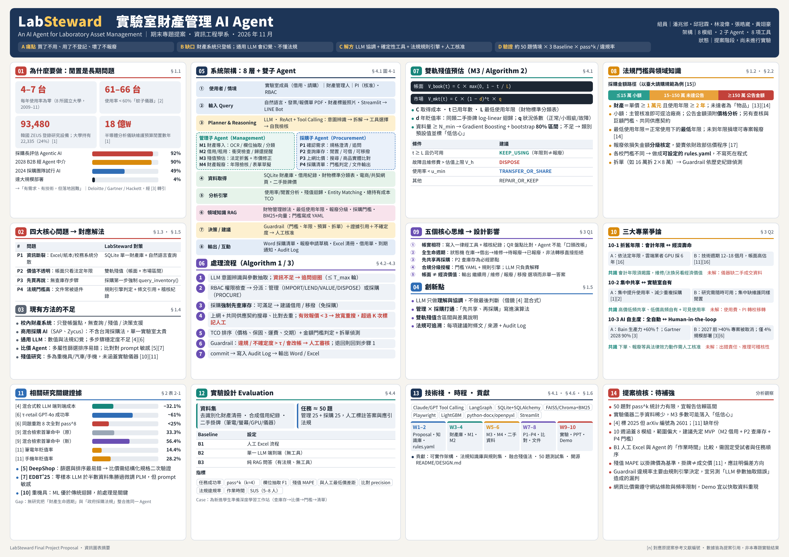

# LabSteward：實驗室財產管理 AI Agent

> An AI Agent for Laboratory Asset Management
> 期末專題提案（資訊工程學系，2026 年 11 月）

LabSteward 是一個結合「財產法規知識」與「工具調用」的實驗室財產管理與採購 AI Agent，目標是解決大學實驗室長期存在的「買了不用、用了不登記、壞了不報廢」問題。

目前狀態：**提案階段，尚未進行實驗。**

## 專題概要

| 項目 | 內容 |
| --- | --- |
| 痛點 | 財產資訊分散、帳面價值不透明、請購前不查庫存導致重複購置、法規門檻高易被退件 |
| 現有方法不足 | 校內財產系統只登帳；通用 LLM 對數值與法規會幻覺；比價 Agent 處理多屬性條件成功率低 |
| 解方 | LLM 負責理解與協調，金額門檻、年限、折舊等判斷交給確定性工具與規則引擎，帳務變更需人工核准 |
| 架構 | 8 層模組、2 個子 Agent（管理 / 採購）、8 項工具 |
| 驗證 | 約 50 題情境任務，對比 3 種 Baseline（人工 Excel、單一 LLM、純 RAG），指標含 pass^k 與法規違規率 |

### 兩大模組

- **管理 Agent**：財產導入（OCR / 欄位抽取）、借用 / 租用登記、雙軌殘值預估（法定帳面價值 + 二手市場估值）、財產報廢（年限檢核、表單草擬）
- **採購 Agent**：確認需求、強制先查庫存與閒置財產、上網比價與商品比對、依金額門檻產出採購清單

### 預計技術棧

Claude / GPT Tool Calling、LangGraph、SQLite + SQLAlchemy、FAISS / Chroma + BM25、Playwright、LightGBM、python-docx / openpyxl、Streamlit

## 文件

`plan/` 資料夾存放提案階段的文件：

| 文件 | 說明 |
| --- | --- |
| [期末專題提案](plan/labsteward-proposal.md) | 提案全文，含摘要、緒論、相關研究、深度研究、系統設計、實驗設計、時程與參考文獻 |
| [提案評析報告](plan/labsteward-proposal-review.md) | 依《期末專題提案作業規範》與 2020 A2Z Outline SOP 檢視提案的合規性與完整度 |
| [研究佐證補充報告](plan/labsteward-supplementary-evidence.md) | 以 2024–2026 年的研究、產業調查、政策與新聞案例，從 Interesting / Innovation / Important 三面向強化提案，並附修訂建議對照表 |
| [資訊圖表](plan/labsteward-infographic-a4-landscape.png) | A4 橫式單頁，彙整問題、架構、流程、殘值模型、法規門檻、實驗設計與待補強事項 |

