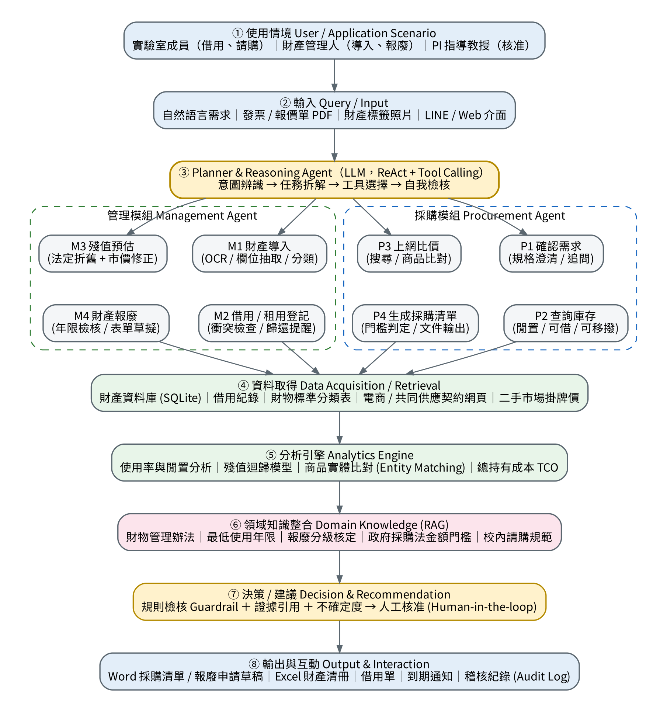
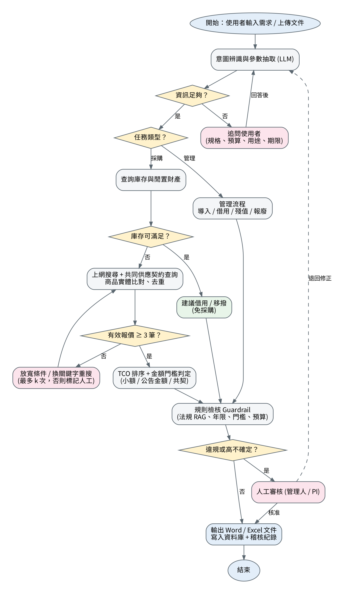

# LabSteward：實驗室財產管理 AI Agent

> 期末專題提案 Final Project Proposal
> An AI Agent for Laboratory Asset Management
> 資訊工程學系｜2026 年 11 月

## 目錄

- [摘要 Abstract](#摘要-abstract)
- [第一章 緒論 Introduction](#第一章-緒論-introduction)
- [第二章 相關研究 Related Work](#第二章-相關研究-related-work)
- [第三章 深度研究 Deep Research](#第三章-深度研究-deep-research)
- [第四章 系統設計 Proposed Scheme](#第四章-系統設計-proposed-scheme)
- [參考文獻 References](#參考文獻-references)

## 摘要 Abstract

**【A. Attention Getter】** 大學實驗室持有大量以公帑購置的儀器與資訊設備，但「買了不用、用了不登記、壞了不報廢」的情形長期存在。監察院調查國科會補助之貴重儀器時發現，8 所國立大學的部分設施在 2009–2011 年間每年有 4–7 台使用率為零、61–66 台使用率低於 60%，專家以「蚊子儀器」形容 [2]；韓國政府於 2026 年 5 月更宣布將研究設備由「教授個人實驗室管理」轉為「全校共享制度」，並自 2027 年起全國普查閒置設備 [1]。同時，採購端正快速走向 AI 化：Deloitte 2026 年調查指出 92% 的採購長正在評估或試行 Agentic AI [3]。

**【B. But】** 然而，現有工具難以直接套用在實驗室場景：其一，校內財產系統多半只做「登帳」，無法回答「這台還值多少錢」「實驗室裡有沒有閒置的可以先借」；其二，通用 LLM 直接當求解器會產生「hallucination tax」，在庫存決策上比混合式架構多出約 32% 成本 [4]，在多步驟工具任務中的穩定度也不足（τ-bench retail 情境 pass^8 低於 25%）[6]；其三，網購比價 Agent 在處理多屬性、篩選與排序條件時成功率仍低 [5]，而且完全不懂政府採購法的金額門檻、財物最低使用年限與報廢分級核定等法規。

**【C. Cure】** 為解決上述問題，本專題提出 LabSteward——一個結合財產法規知識與工具調用的實驗室財產管理與採購 AI Agent，涵蓋「管理」（財產導入、借用 / 租用登記、殘值預估、財產報廢）與「採購」（確認需求、查詢庫存、上網比價、生成採購清單）兩大模組。

**【D. Development】** 系統以 LLM Planner（ReAct 式推理與 Tool Calling）負責理解需求與拆解任務，但把「需要正確答案」的部分交給確定性工具：SQLite 財產資料庫、以財物標準分類與二手市場資料建構的殘值模型、商品實體比對（entity matching）、以及以法規條文建立的 RAG 知識庫與規則檢核（Guardrail）。所有會改變帳務狀態的動作都需經人工核准並寫入稽核紀錄，最後輸出 Word / Excel 格式的採購清單、報廢申請草稿與借用單。

**【E. Experiments】** 預計以本實驗室去識別化財產清冊為主、合成資料為輔，建立約 50 個管理與採購情境任務，比較三種 Baseline：人工 Excel 流程、單一 LLM 端到端回答（無工具）、純 RAG 問答。評估指標包含任務成功率與 pass^k 穩定度、欄位抽取 F1、殘值預估 MAPE、比價結果與人工最低價差距、商品比對 precision、法規違規率與作業時間。

**【F. Expected Outcomes】** 本專題尚未進行實驗，以下為預期成果：(1) 法規違規率應明顯低於單一 LLM baseline，因法規判斷由規則引擎而非 LLM 決定；(2)「先查庫存再採購」的流程預期可找出部分可借用 / 移撥的閒置設備；(3) 殘值預估能提供帳面價值與市場價值的雙軌估計與區間；(4) 產出可直接送審的文件草稿，降低管理人員的文書時間。

**關鍵字：** AI Agent、財產管理、殘值預估、政府採購、Tool Calling、RAG、Human-in-the-loop

## 第一章 緒論 Introduction

### 1.1 Attention Getter：研究設備閒置是公開且長期的問題

研究設備的「低使用率」不是單一學校的問題。監察院 2013 年針對國科會貴重儀器補助的調查報告指出，2007–2011 年國科會每年平均補助約 2.2 億元購置 13 台貴重儀器，但 2011 年查核發現 8 所國立大學使用率偏低，部分核心設施全年服務次數不到 100 次，且補助計畫結束後缺乏退場與營運機制 [2]。十多年後，同樣的問題仍是政策焦點：韓國科技部與教育部 2026 年 5 月提出的研究基礎設施開放政策中，全國設備系統（ZEUS）登錄 93,480 件研究設備，其中大學持有 22,335 件（約 24%），並舉例一台價值 18 億韓元的半導體分析儀器因缺乏維護預算而閒置數年 [1]。

另一方面，採購流程正被 Agentic AI 重塑。依 Procurement Magazine 2026 年彙整，Gartner 預測 2028 年 90% 的 B2B 採購將經由 AI Agent 中介；但 The Hackett Group 2025 年研究也指出，2024 年有 49% 採購團隊試行 AI，僅 4% 達到大規模部署 [3]。換言之，「有需求、有技術，但落地困難」正是目前的狀態。

### 1.2 Background：應用領域、使用者與技術背景

在台灣的大專校院，單價新台幣 1 萬元以上且使用年限 2 年以上的設備屬於「財產」，未達者為「物品」[13][14]；財產需列帳、指定保管人，並依《財物標準分類》所定最低使用年限辦理報廢 [14]。採購端則受政府採購法與校內請購規範約束，例如 15 萬元以下為小額採購、150 萬元以上達公告金額，並可透過共同供應契約下單 [15]。

實驗室中的主要使用者有三類：實驗室成員（借用設備、提出請購）、財產管理人 / 助理（登帳、盤點、報廢）、指導教授（PI）（核准採購與報廢）。技術背景上，LLM Agent 透過 ReAct 式「推理—行動」交錯 [12] 與 Tool Calling 已能操作資料庫與網頁，Agentic RAG 進一步讓 Agent 自主決定何時檢索、檢索什麼 [8]。

### 1.3 Problem：真正要解決的問題

本專題聚焦以下四個具體問題：

1. **資訊斷裂**：財產清冊、借用紀錄、採購文件分散在 Excel、紙本與學校系統中，無法回答「實驗室現在有哪些可借的 GPU 主機？」這類問題。
2. **價值不透明**：帳面價值只反映法定年限，無法回答「這台三年前買的示波器現在還值多少？要修還是要換？」
3. **先買再說**：請購前缺乏「先查庫存、閒置與可移撥財產」的強制步驟，導致重複購置。
4. **法規門檻高**：學生與助理不熟悉金額門檻、報價份數、最低使用年限與報廢分級核定，文件常被退件。

### 1.4 Existing Limitations：現有方法的不足

- **校內財產系統**：以登帳與盤點為主，缺乏自然語言查詢、殘值估算與採購決策支援。
- **商用採購 AI（如 SAP、Zycus 等）**：為企業採購流程設計，未內建台灣政府採購法與公立學校財物管理規範，對單一實驗室而言也過於昂貴。
- **通用 LLM 聊天機器人**：直接回答數值與法規問題會幻覺；研究顯示把 LLM 當端到端求解器時成本明顯較高 [4]，且多步驟工具任務穩定度不足 [6]。
- **網購比價 Agent**：在多屬性、篩選與排序需求上成功率仍低 [5]；商品比對對 prompt 寫法高度敏感 [7]。
- **殘值預估研究**：多集中於重型機具、汽車或手機 [10][11]，較少處理實驗室儀器這類「交易資料稀少、規格差異大」的資產。

### 1.5 Innovation：本專題的不同之處

- **LLM 只做「理解與協調」，不做「最後判斷」**：借鏡 [4] 的混合式架構，金額門檻、年限、折舊計算一律交給確定性程式與規則引擎，LLM 負責追問、拆解與解釋。
- **管理與採購打通**：採購流程第一步強制查詢自有庫存與閒置財產，把「先共享、再採購」寫進演算法。
- **雙軌殘值**：同時輸出法定帳面價值與市場估值（含區間），並說明差異來源。
- **法規可追溯**：每一項建議都附上引用的法規條文或資料來源，並寫入稽核紀錄。

### 1.6 Contributions：預期貢獻

1. 提出一個可實作的實驗室財產管理與採購 Agent 架構（8 個模組、2 個子 Agent、8 項工具）。
2. 建立台灣大專校院財產與採購法規的結構化知識庫與規則集，可供其他實驗室重用。
3. 提出融合法定折舊與二手市場資料的殘值預估方法，並以區間呈現不確定度。
4. 建立約 50 題實驗室情境測試集與評估指標（含法規違規率與 pass^k 穩定度）。
5. 開源 GitHub 專案、README.md 與 DESIGN.md，使後續開發者可接手。

## 第二章 相關研究 Related Work

### 2.1 AI Technology

**(1) LLM Agent 與工具調用**

ReAct 讓語言模型在「思考」與「呼叫工具」之間交錯，是目前多數 Agent 框架的基礎 [12]。τ-bench 則專門評估 Agent 在「工具—Agent—使用者」三方互動下是否遵守領域規則：即使是 GPT-4o，在零售情境的成功率約 61%，同一任務重跑 8 次都成功的比例（pass^8）更低於 25% [6]。這提醒本專題：財產與採購屬於「錯一次就有後果」的場景，必須量測穩定度而不只是平均成功率。

**(2) 混合式架構：LLM + 確定性求解器**

Duan 等人（2025）在中小企業庫存管理中比較了「LLM 端到端求解」與「LLM 擷取參數 + 呼叫最佳化演算法」兩種做法，後者總成本降低 32.1%；更重要的是，即使給 GPT-4o 完整正確資訊，端到端表現也未改善，顯示瓶頸在計算推理而非資訊不足 [4]。本專題的殘值計算與門檻判定即採此原則。

**(3) Agentic RAG 與領域知識庫**

Agentic RAG 綜述將「由 Agent 決定檢索策略、反覆查證」整理為新的設計模式 [8]。Liu 等人（2025）以 3,500 篇材料論文建立輕結構化文字資料庫，結合向量檢索、BM25 與數值過濾，首筆命中率由 33.3% 提升至 56.4%，並實際引導實驗室製程 [9]。本專題將以同樣的「混合檢索 + 數值過濾」處理法規條文與財產資料。

**(4) 網購 Agent 與商品比對**

DeepShop（2025）指出既有購物 Agent 基準過於簡單，在多屬性、篩選與排序需求下，RAG 因無法與網頁互動而表現不佳，網頁 Agent 也有明顯的篩選與排序錯誤 [5]。Peeters 等人（EDBT 2025）則顯示 LLM 在商品實體比對上，零樣本即可在一半的資料集上勝過微調的 PLM，但對 prompt 寫法高度敏感 [7]。因此本專題比價模組會以結構化規格欄位做二次驗證，而非只靠 LLM 判斷「是不是同一個商品」。

### 2.2 Domain Know-how

**(1) 財產定義、最低使用年限與報廢**

依各校財物管理辦法與《財物標準分類》總說明：單價 1 萬元以上且使用年限 2 年以上為財產；最低使用年限是「正常使用下的最低年限」，達到年限不代表應報廢，仍可使用者應延後報廢；未達年限而損壞無法修復者，得依程序專案報廢 [13][14]。報廢依損失金額分級核定，並有《各機關奉准報廢財產之變賣及估價作業程序》規範後續處分 [13][17]。

**(2) 採購金額門檻與流程**

以國立臺灣大學請購作業規範為例：15 萬元以下為小額採購，經單位主管核准即可逕洽廠商；150 萬元以上為公告金額，請購時須附價格分析；並另有查核金額與巨額採購門檻；共同供應契約則透過電子採購系統下訂 [15]。各校細節不同，因此系統的門檻須做成可設定的規則檔，而非寫死在程式中。

**(3) 殘值與折舊**

Huymajer 等人（2025）以真實重型機具交易資料比較多種迴歸方法，發現機器學習模型明顯優於傳統方法，但前處理與參數調整至關重要 [10]。Řezníček 與 Kropík 以二手平台掛牌資料估計，筆電每年約貶值 14.4%、手機約 28.2%，並發現 log-linear（指數型）模型較線性模型更貼近電子產品 [11]。此外，2025 年科技業對 GPU 折舊年限（雲端業者採 6 年 vs. 批評者認為 2–3 年）的爭論，也說明「會計年限」與「經濟壽命」可能相差甚大 [16]。

**(4) 設備共享與使用率**

監察院報告 [2] 與韓國 2026 年政策 [1] 皆指出：昂貴設備閒置的根源包括缺乏使用率追蹤、維護預算與人員，以及計畫結束後無退場機制。這直接支持本專題「借用登記 → 使用率分析 → 採購前查庫存」的設計。

### 2.3 Article Summary Table

表 2-1 整理與本專題最相關的 8 篇研究（著重 2025–2026 年）。

| Ref. | Year | Problem | AI Method | Domain Knowledge | Dataset | Findings | Limitation |
| --- | --- | --- | --- | --- | --- | --- | --- |
| [4] | 2025 | 中小企業缺乏庫存最佳化能力 | LLM 擷取參數 + 呼叫 OR 求解器；Human Imitator 模擬使用者 | 庫存管理、隨機需求 | 模擬互動（Human Imitator） | 總成本較 GPT-4o 端到端降低 32.1%；給完整資訊仍無改善 | 以模擬經理人評估，非真實使用者 |
| [6] | 2024 | Agent 能否在遵守規則下與使用者及工具互動 | Tool-calling Agent；提出 pass^k 指標 | 零售、航空客服政策 | τ-retail、τ-airline 任務 | GPT-4o retail 成功率約 61%，pass^8 < 25% | 僅兩個領域；使用者以 LLM 模擬 |
| [5] | 2025 | 購物 Agent 基準過於簡單 | RAG、Web Agent、Deep Research 系統 | 電商商品屬性、篩選、排序 | DeepShop（5 類、3 難度） | 複雜查詢下成功率低；篩選與排序最易錯 | 以國外電商為主；未涵蓋採購法規 |
| [7] | 2025 | 商品 / 實體比對泛化能力不足 | GPT-4o、Llama 3.1 等零樣本 / 少樣本 / 微調 | 商品實體比對 | WDC Products 等 | 零樣本 LLM 於一半資料集勝過微調 PLM | 對 prompt 高度敏感 |
| [8] | 2025 | RAG 流程僵化 | Agentic RAG 分類與設計模式綜述 | 跨領域 | 文獻綜述 | 整理反思、規劃、工具、多 Agent 等模式 | 綜述性質，無實驗 |
| [9] | 2025 | 實驗室製程知識多為非結構文字 | 輕結構資料庫 + 混合檢索 + 推理 LLM | 材料製程（BNNS） | 3,500+ 篇論文；200 題查詢 | 首筆命中 56.4%（baseline 33.3%）；引導實驗 | 單一材料案例；依賴閉源模型 |
| [10] | 2025 | 重型機具殘值預估 | 多種迴歸與 ML 模型比較；變數重要度 | 機具折舊、交易價格 | 建設公司二手機具交易資料 | ML 明顯優於傳統方法；前處理關鍵 | 單一產業；未涵蓋實驗儀器 |
| [11] | 未載* | 動產年齡與二手價格關係 | 線性 / log-linear 迴歸、Random Forest | 汽車、手機、筆電折舊 | 二手平台 2,100 筆掛牌 | 筆電年貶值約 14.4%、手機約 28.2% | 掛牌價非成交價；樣本小、單一平台 |

\* 該文未標示出版年份，文中引用 2026 年資料。

### 2.4 Existing Research → Limitations → Research Gap → Our Project

| 階段 | 內容 |
| --- | --- |
| Existing Research | LLM Agent 已能調用工具 [6][12]；混合式架構可降低決策成本 [4]；Agentic RAG 能整合領域文獻 [8][9]；ML 可預估二手殘值 [10][11]；LLM 可做商品比對 [7]。 |
| Limitations | 穩定度不足（pass^k 低）[6]；購物 Agent 在篩選 / 排序易錯 [5]；殘值研究未涵蓋實驗儀器；沒有研究把「財產生命週期」與「政府採購法規」整合到同一個 Agent。 |
| Research Gap | 缺少一個「懂台灣公立學校財物與採購法規、能先查庫存再比價、能估殘值、且可稽核」的實驗室層級 Agent。 |
| Our Project | LabSteward：LLM 協調 + 確定性工具 + 法規規則引擎 + 人工核准，涵蓋管理與採購兩模組，並以 pass^k 與法規違規率評估。 |

## 第三章 深度研究 Deep Research

### Q1. 五個核心思維模式（Five Mindsets）

| 思維模式 | 意義 | 證據 | 對系統設計的影響 |
| --- | --- | --- | --- |
| 1. 帳實相符 (Record = Reality) | 帳上的每件財產都必須找得到、對得上保管人與位置；盤點就是驗證帳實一致。 | 各校財物管理辦法明定保管人責任、盤點與減損程序 [13]。 | 所有寫入動作都經工具執行並留下稽核紀錄；Agent 不能「口頭」改帳；支援以財產標籤 QR 碼盤點比對。 |
| 2. 全生命週期 (Lifecycle) | 財產從取得、使用、維護、移轉到報廢 / 變賣是一條完整鏈，任何決策都要看所處階段。 | 法規分別規範取得、減損、報廢、讓與與變賣估價 [13][17]。 | 以狀態機（在庫 → 借出 → 維修 → 待報廢 → 已報廢）管理每件財產，非法狀態轉移直接拒絕。 |
| 3. 先共享，再採購 (Utilize before Acquire) | 採購前先確認既有或閒置資源能否滿足需求。 | 監察院發現大量低使用率儀器 [2]；韓國 2026 年轉向共享制度 [1]。 | 採購流程第一步強制呼叫 `query_inventory()`；若有可借 / 可移撥設備，建議優先使用。 |
| 4. 合規與分級授權 (Compliance by Threshold) | 同一件事因金額、年限不同，流程與核准層級完全不同。 | 財產 1 萬元 / 2 年定義 [13]；小額 15 萬、公告 150 萬 [15]；報廢依金額分級核定 [13]。 | 門檻寫成可設定的規則檔（YAML），由規則引擎判定；LLM 只負責解釋判定結果。 |
| 5. 帳面價值 ≠ 經濟價值 (Book vs. Economic Value) | 法定年限是會計與管理工具，不代表設備實際價值或可用性。 | 年限已到仍可用者不應報廢 [14]；筆電年貶值約 14.4% [11]；GPU 年限爭議 [16]。 | 殘值模組同時輸出帳面價值與市場估值區間，並把「繼續使用 / 維修 / 報廢 / 移撥」作為選項而非單一答案。 |

### Q2. 三個最重要的專業爭論（Three Controversies）

**爭論一：折舊年限——法定 / 會計年限 ↔ 實際經濟壽命**

- **觀點 A**：應依法定或會計年限折舊，確保一致性與可稽核性；雲端業者普遍採 6 年折舊 GPU [16]。
- **觀點 B**：運算設備技術週期約 12–18 個月，經濟壽命遠短於帳面年限，帳面價值會高估資產 [16]；二手資料也顯示電子產品呈指數型貶值 [11]。
- **Consensus**：會計年限是政策選擇，必須揭露；決策（維修或汰換）應另看經濟價值。
- **Unresolved**：實驗儀器缺乏二手成交資料，經濟價值如何可靠估計？

**爭論二：集中共享 ↔ 實驗室自有**

- **觀點 A（集中）**：集中管理可提升使用率、降低重複採購 [1][2]。
- **觀點 B（自有）**：研究時程需要隨時可用的設備；集中後若缺維護預算與人力同樣會閒置（韓國 18 億韓元儀器案例）[1]。
- **Consensus**：高價、低頻使用設備走共享；低價、高頻設備留在實驗室，但需有借用紀錄與使用率可見性。
- **Unresolved**：成本回收（使用費）如何訂？PI 轉校時設備如何移轉 [1]？

**爭論三：AI 自主程度——全自動 Agentic Procurement ↔ Human-in-the-loop**

- **觀點 A（高自主）**：Agent 可大幅提高採購效率，Bain 報告生產力可提升 60% 以上；Gartner 預測 2028 年 90% B2B 採購由 Agent 中介 [3]。
- **觀點 B（人在迴路）**：Gartner 同時預測 2027 年底前超過 40% 的 Agentic AI 專案會被取消；Hackett 指出僅 4% 能大規模部署 [3]；τ-bench 顯示穩定度不足 [6]；LLM 端到端有 hallucination tax [4]。
- **Consensus**：LLM 作為自然語言介面與協調者，關鍵計算交給確定性工具，具法律效力的動作（下單、報廢）需人工核准。
- **Unresolved**：Agent 出錯的責任歸屬？如何讓 LLM 的推理過程達到稽核要求？

### Q3. 十個深度理解問題（Ten Deep Questions）

| # | 推理層次 | 問題 |
| --- | --- | --- |
| 1 | Why | 為什麼財產的門檻要同時看「金額」與「使用年限」，只看金額會出什麼問題？ |
| 2 | What-if | 一台已超過最低使用年限、仍可正常運作的示波器，PI 想換新機；系統應該怎麼建議？為什麼不能直接建議報廢？ |
| 3 | Trade-off | 採購一台 14 萬元與一台 16 萬元的設備，價差只有 2 萬，但流程差異是什麼？何時多花錢反而更划算？ |
| 4 | Failure Case | 比價 Agent 找到一個比市價便宜 40% 的商品，可能是哪些原因？系統應如何處理？ |
| 5 | Evidence | 你如何證明實驗室「真的需要」再買一台 GPU 主機，而不是使用率不足？需要哪些資料？ |
| 6 | Comparison | 直線法折舊與指數型（定率）折舊，分別適合哪些實驗室設備？各自會讓殘值高估或低估在哪個階段？ |
| 7 | Design Decision | 為什麼金額門檻判定要用規則引擎而不是讓 LLM 讀法規後判斷？若法規修訂，兩者的維護成本有何不同？ |
| 8 | Real-world Scenario | 學生畢業離校，但他名下保管 3 件財產且有 1 件借出未還，系統應該觸發哪些流程？ |
| 9 | What-if | 若同一需求被拆成兩張 8 萬元的請購單，可能違反什麼原則？Agent 如何偵測？ |
| 10 | Trade-off | 借用登記要求越嚴格（押金、審核）資料越完整，但使用者越可能不登記；你會如何取捨？ |

## 第四章 系統設計 Proposed Scheme

### 4.1 System Architecture



*圖 4-1　LabSteward 系統架構圖*

各模組說明如下：

| 編號 | 模組 | 說明 |
| --- | --- | --- |
| ① | User / Application Scenario | 三類使用者：實驗室成員（借用、請購）、財產管理人（導入、盤點、報廢）、PI（核准）。依角色授權不同工具（RBAC）。 |
| ② | Query / Input | 支援自然語言、發票 / 報價單 PDF、財產標籤照片；介面先以 Web（Streamlit）實作，可延伸至 LINE Bot。 |
| ③ | Planner & Reasoning Agent | LLM 以 ReAct 方式辨識意圖、抽取參數、資訊不足時追問，將任務分派給「管理子 Agent」或「採購子 Agent」，並在輸出前自我檢核。 |
| M1–M4 | 管理模組 | M1 導入：從發票 / 報價單 OCR 抽取品名、規格、金額、日期並建議財物分類；M2 借用 / 租用：檢查時段衝突、建立借用單、到期提醒；M3 殘值：計算雙軌殘值；M4 報廢：檢核年限與狀態、產生報廢申請草稿。 |
| P1–P4 | 採購模組 | P1 確認需求：用途、規格、數量、預算、期限；P2 查詢庫存：在庫、閒置、可移撥；P3 上網比價：搜尋電商與共同供應契約，商品實體比對與去重；P4 採購清單：依金額判定流程，輸出含報價來源的清單。 |
| ④ | Data Acquisition / Retrieval | SQLite 財產資料庫與借用紀錄、財物標準分類表、網頁搜尋與擷取（Playwright）、二手市場掛牌價。 |
| ⑤ | Analytics Engine | 使用率 / 閒置分析、殘值迴歸模型（log-linear / Gradient Boosting）、商品實體比對（規格欄位 + LLM 判斷）、總持有成本 TCO 排序。 |
| ⑥ | Domain Knowledge (RAG) | 將財物管理辦法、財物標準分類、報廢分級、校內請購規範切塊建立向量索引（混合 BM25 + 向量），另將門檻與年限寫成 YAML 規則檔。 |
| ⑦ | Decision & Recommendation | Guardrail 規則檢核（門檻、年限、預算、拆單偵測），附上證據引用與不確定度；高風險或違規時轉人工審核。 |
| ⑧ | Output & Interaction | 產生 Word 採購清單 / 報廢申請草稿、Excel 財產清冊、借用單與通知，並寫入稽核紀錄（Audit Log）。 |

#### 殘值預估方法（M3）

**帳面價值**：以直線法計算 `V_book(t) = C × max(0, 1 − t / L)`，其中 C 為取得成本、t 為已使用年數、L 為該類財產之最低使用年限（由財物標準分類表查得，校方若採不同公式可在設定檔替換）。

**市場價值**：`V_mkt(t) = C × (1 − d)^t × q`，其中年貶值率 d 以同類別二手掛牌資料做 log-linear 迴歸估計（參考 [11] 的做法），q 為狀況係數（正常 / 小瑕疵 / 故障）。若某類別資料量足夠，改用 Gradient Boosting 模型並以 bootstrap 產生 80% 預測區間；資料不足時退回類別預設值並標示「低信心」。

**輸出**：兩種價值與區間、差異說明，以及「繼續使用 / 維修 / 移撥 / 報廢」的建議與依據。

#### 技術可行性（Technical Feasibility）

| 項目 | 選用技術 | 理由 |
| --- | --- | --- |
| LLM | Claude / GPT 系列 API（支援 Tool Calling） | 原生函式呼叫、長上下文，可處理法規條文 |
| Agent 框架 | LangGraph 或自行實作狀態機 | 可明確控制流程、迴圈上限與人工核准節點 |
| 資料庫 | SQLite + SQLAlchemy | 單一實驗室規模足夠，易於交接 |
| 向量檢索 | FAISS / Chroma + BM25 | 混合檢索提升法規條文命中率 [9] |
| 網頁擷取 | Playwright + 搜尋 API | 處理動態網頁；遵守網站使用條款與頻率限制 |
| 分析 | pandas、scikit-learn、LightGBM | 殘值迴歸與使用率分析 |
| 文件輸出 | python-docx、openpyxl | 產生 Word / Excel 送審文件 |
| 介面 | Streamlit（Web） | 快速原型，可展示 Demo |

### 4.2 Flowchart



*圖 4-2　LabSteward 處理流程圖（含追問迴圈、重搜例外與人工審核）*

流程重點：(1) 資訊不足時回到追問迴圈；(2) 採購流程必經庫存查詢，可滿足時直接轉借用 / 移撥；(3) 有效報價不足 3 筆時放寬條件重搜，超過 k 次則標記人工處理；(4) 所有路徑最後都經 Guardrail，違規或高不確定時進入人工審核，審核退回則回到意圖辨識。

### 4.3 Pseudocode

```text
Algorithm 1: LabSteward Agent (Main Loop)
Input : user query Q, user role r, attachments F
Output: result R with evidence E and audit record A

01: intent, params <- LLM.parse(Q, F)
02: while missing(params, intent) and turns < T_max do
03:     params <- params + ask_user(clarify_questions(intent, params))
04: end while
05: if not authorized(r, intent) then return Deny("permission")
06: if intent in {IMPORT, LEND, VALUE, DISPOSE} then
07:     R <- ManagementAgent(intent, params)
08: else if intent = PROCURE then
09:     R <- ProcurementAgent(params)          // Algorithm 3
10: end if
11: E <- KB.retrieve(intent, R)               // regulation citations
12: violations <- RuleEngine.check(R, rules.yaml)
13: if violations != {} or R.uncertainty > tau or R.commits_state then
14:     decision <- human_review(R, E, violations)
15:     if decision = REJECT then return LabSteward(Q + feedback)
16: end if
17: commit(R); A <- audit_log(Q, R, E, decision)
18: return render_docs(R, E)                 // Word / Excel
```

```text
Algorithm 2: Dual-track Residual Value Estimation (M3)
Input : asset a (cost C, category k, purchase date, condition c)
Output: book value Vb, market value interval [Vl, Vh], advice

01: t <- years_since(a.purchase_date)
02: L <- StdClassTable.min_life(k)            // 最低使用年限
03: Vb <- C * max(0, 1 - t / L)
04: D <- MarketData.listings(similar_to(a))
05: if |D| >= N_min then
06:     model <- GBM.fit(D); [Vl, Vh] <- bootstrap_interval(model, a)
07: else
08:     d <- LogLinear.fit(category_data(k)).rate or default_rate(k)
09:     Vm <- C * (1 - d)^t * q(c); [Vl, Vh] <- Vm * (1 -/+ delta)
10:     flag LOW_CONFIDENCE
11: end if
12: if t >= L and a.working then advice <- KEEP_USING   // 年限到仍可用
13: else if not a.working and repair_cost(a) > Vh then advice <- DISPOSE
14: else if utilization(a) < u_min then advice <- TRANSFER_OR_SHARE
15: else advice <- REPAIR_OR_KEEP
16: return Vb, [Vl, Vh], advice
```

```text
Algorithm 3: Procurement Agent (P1-P4)
Input : requirement params p (spec, qty, budget, deadline)
Output: purchase list PL or borrow/transfer suggestion

01: S <- normalize_spec(p.spec)                       // P1
02: I <- Inventory.query(S, status in {IN_STOCK, IDLE}) // P2
03: if I satisfies p.qty then return Suggest(borrow_or_transfer, I)
04: offers <- {}; k <- 0
05: repeat                                             // P3
06:     raw <- WebSearch(S) + JointSupplyContract(S)
07:     offers <- dedupe(EntityMatch(raw, S))         // spec check + LLM
08:     S <- relax(S); k <- k + 1
09: until |offers| >= 3 or k >= K_max
10: if |offers| < 3 then mark NEED_MANUAL_QUOTES
11: ranked <- sort(offers, by = TCO(price, warranty, shipping, lead_time))
12: total <- best(ranked).price * p.qty
13: route <- Rules.threshold(total)    // small / under-announce / announce
14: if split_order_suspected(p, history) then flag VIOLATION
15: PL <- build_list(ranked, route, sources, budget_check(total, p.budget))
16: return PL                                          // P4
```

### 4.4 實驗設計 Evaluation Plan

| 項目 | 設計 |
| --- | --- |
| Dataset | (1) 本實驗室財產清冊（去識別化）；(2) 合成財產與借用紀錄；(3) 二手市場掛牌資料（筆電、螢幕、GPU、量測儀器）；(4) 約 50 題情境任務（管理 25、採購 25），由人工標註正確答案與應引用法規。 |
| Baselines | B1 人工 Excel 流程；B2 單一 LLM 端到端（無工具）；B3 純 RAG 問答（有法規、無工具）。 |
| Metrics | 任務成功率與 pass^k（k = 4）[6]；欄位抽取 F1；殘值 MAPE（對照掛牌 / 成交價）；比價：與人工最低價差距、商品比對 precision；法規違規率；作業時間；使用者滿意度（SUS 問卷，5–8 位實驗室成員）。 |
| Case Study | 「為新進學生準備一台深度學習工作站」完整流程：查庫存 → 比價 → 門檻判定 → 輸出採購清單。 |

### 4.5 GitHub Repository 與 DESIGN.md 規劃

```text
labsteward/
├── README.md           # 專題介紹、Installation、How to Run、Demo
├── DESIGN.md           # Problem → Requirements → Architecture → ... → Results
├── agent/              # planner.py, management_agent.py, procurement_agent.py
├── tools/              # inventory, lending, valuation, web_search, docgen
├── knowledge/          # regulations/*.md, rules.yaml, std_class_table.csv
├── data/               # sample_assets.csv, market_listings.csv (去識別化)
├── eval/               # tasks.jsonl, run_eval.py, metrics.py
└── app/                # streamlit_app.py
```

### 4.6 預定時程

| 週次 | 工作項目 |
| --- | --- |
| W1–W2 | Proposal、GitHub 與 DESIGN.md 初版；法規知識庫與 rules.yaml |
| W3–W4 | 財產資料庫、M1 導入、M2 借用登記 |
| W5–W6 | M3 殘值模型、M4 報廢；二手資料蒐集 |
| W7–W8 | P1–P4 採購模組、商品比對、文件輸出 |
| W9–W10 | 實驗評估、Baseline 比較、Final PPT 與 Demo 影片 |

## 參考文獻 References

1. Asia Economy. (2026, May 29). Ministry of Education and Ministry of Science and ICT to promote opening of university research infrastructure. https://view.asiae.co.kr/en/article/2026052912524106923
2. 監察院（2013 年 1 月 25 日）。國科會補助貴重儀器相關調查報告。https://cybsbox.cy.gov.tw/CYBSBoxSSL/edoc/download/3741
3. Procurement Magazine. (2026). Agentic AI in procurement: Gartner, Bain, Unilever & Revolut. https://procurementmag.com/news/agentic-ai-in-procurement-gartner-bain-unilever-revolut
4. Duan, Y., Hu, Y., & Jiang, J. (2025). Ask, clarify, optimize: Human-LLM agent collaboration for smarter inventory control. arXiv:2601.00121.
5. Lyu, Y., Zhang, X., Yan, L., de Rijke, M., Ren, Z., & Chen, X. (2025). DeepShop: A benchmark for deep research shopping agents. arXiv:2506.02839.
6. Yao, S., Shinn, N., Razavi, P., & Narasimhan, K. (2024). τ-bench: A benchmark for tool-agent-user interaction in real-world domains. arXiv:2406.12045.
7. Peeters, R., Steiner, A., & Bizer, C. (2025). Entity matching using large language models. Proceedings of EDBT 2025. arXiv:2310.11244.
8. Singh, A., Ehtesham, A., Kumar, S., & Talaei Khoei, T. (2025). Agentic retrieval-augmented generation: A survey on agentic RAG. arXiv:2501.09136.
9. Liu, Y., Zhang, Z., Zeng, X., Zhang, Y., Yu, L., Yang, L., Wang, L., & Yu, X. (2025). Language-native materials processing design by lightly structured text database and reasoning large language model. arXiv:2509.06093.
10. Huymajer, M., Filzmoser, P., Mazak-Huemer, A., Winkler, L., & Kraxner, H. (2025). Opportunities and pitfalls of regression algorithms for predicting the residual value of heavy equipment: A comparative analysis. *Engineering Applications of Artificial Intelligence, 141*, 109599. https://doi.org/10.1016/j.engappai.2024.109599
11. Řezníček, T., & Kropík, T. (n.d.). The effect of age and selected characteristics on the asking price of movable property. Institute of Technology and Business in České Budějovice. https://journals.vstecb.cz/
12. Yao, S., Zhao, J., Yu, D., Du, N., Shafran, I., Narasimhan, K., & Cao, Y. (2023). ReAct: Synergizing reasoning and acting in language models. ICLR 2023. arXiv:2210.03629.
13. 國立雲林科技大學。財物管理辦法。https://green.yuntech.edu.tw/myuploads/aboutF_doc/A01.pdf
14. 行政院主計總處。財物標準分類總說明（國立暨南國際大學轉載）。https://general.ncnu.edu.tw/var/file/26/1026/img/342/600566549.pdf
15. 國立臺灣大學總務處（2023 年 3 月 17 日）。請購作業規範（ISO）。https://ga.ntu.edu.tw/
16. Vellante, D. (2025, November 22). Breaking Analysis: GPU depreciation and useful life. SiliconANGLE. https://siliconangle.com/?p=722516
17. 財政部。各機關奉准報廢財產之變賣及估價作業程序。https://law-out.mof.gov.tw/
